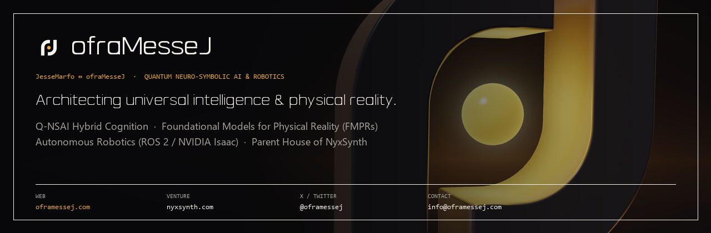

  

  
  
  
  

---

### `JesseMarfo ↔ ofraMesseJ` · Independent Deep-Tech Architecture House

**ofraMesseJ** architects quantum-augmented neuro-symbolic cognition (**Q-NSAI**), **Foundational Models for Physical Reality (FMPRs)**, autonomous robotics (**ROS 2** · **NVIDIA Isaac**), and sovereign frontier ventures — founded by **Jesse Marfo** (*Founder & Chief Architect*).

---

### Core Systems & Engineering

| Repository | Domain | Summary |
| :--- | :--- | :--- |
| [**`archon-system`**](https://github.com/ofraMesseJ/archon-system) | Multi-Agent AI · Python | Autonomous ecosystem uniting Cortex neuro-symbolic reasoning, Business ops, Fortress security & Citadel edge deployment |
| [**`AgentVault`**](https://github.com/ofraMesseJ/AgentVault) | Agent Runtime · Python | Hardened execution sandbox with 9 native tools (Bash, Browser, DB, Email, Calendar, GitHub, HTTP, File, Python), WebSocket & Docker |
| [**`LifeVault`**](https://github.com/ofraMesseJ/LifeVault) | Personal OS · Local-First | Sovereign zero-cloud Personal Life Operating System for journaling, habits, expenses, goals & Pomodoro focus |

---

### Research Monographs

| Code | Monograph | Focus |
| :--- | :--- | :--- |
| **`MON-01`** | [**The Business Case for Neuro-Symbolic AI**](https://github.com/ofraMesseJ/Neuro-Symbolic-AI) | Beyond the black box — explainable, data-efficient, compliance-ready AI |
| **`MON-02`** | [**The Universal Impact Blueprint™**](https://github.com/ofraMesseJ/The-Universal-Impact-Blueprint) | Four-stage methodology (*Conceptualize → Synthesize → Actualize → Transcend*) |
| **`MON-03`** | [**Quantum Cognition (Q-NSAI)**](https://github.com/ofraMesseJ/Quantum-Cognition) | Quantum-accelerated symbolic reasoning across tensor solvers, NISQ & FTQC |
| **`MON-04`** | [**Architecting Reality (FMPRs)**](https://github.com/ofraMesseJ/Architecting-Reality) | Multi-modal sensory fusion, causal reasoning & safe physical motor policies |

---

### Sovereign Venture Ecosystem

- **[NyxSynth](https://nyxsynth.com)** — Post-quantum machine settlement & BCP Layer-1 infrastructure engineered for autonomous AI agents (NIST FIPS 204 / ML-DSA-65).

---

© 2026 ofraMesseJ · Chiral Architecture · <a href="https://oframessej.com">oframessej.com</a>
